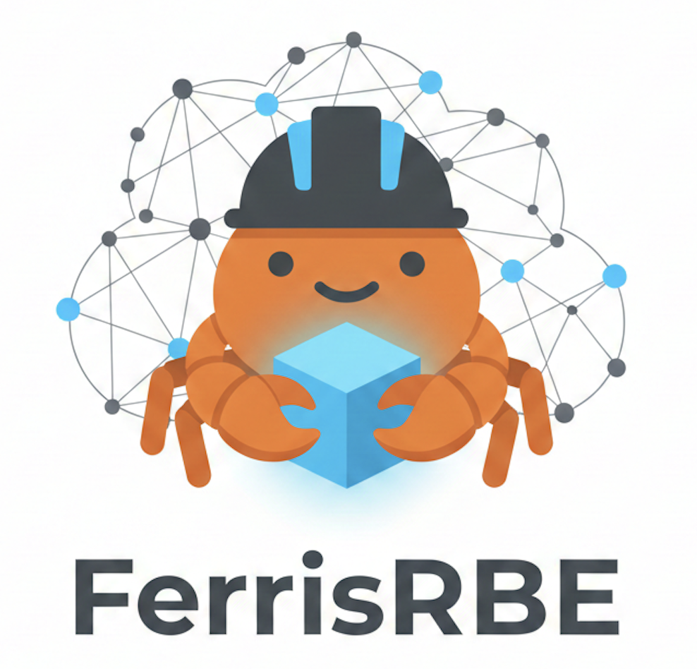

<p align="center">
  
</p>

<h1 align="center">FerrisRBE</h1>

<p align="center">
  Remote cache, remote execution and build event service for Bazel, in Rust.
</p>

---

FerrisRBE is two binaries:

- **`server`** serves the Remote Execution API v2 (CAS, Action Cache,
  ByteStream, Execution, Capabilities), the Remote Asset API, the Build Event
  Service with a web UI, a pull-through download proxy, an MCP endpoint over
  the build data, and Prometheus metrics.
- **`worker`** runs the actions the server schedules. Workers connect to the
  server, so they can scale in and out without any registration step.

Both ship as multi-platform images (`linux/amd64`, `linux/arm64`):

```bash
docker pull docker.io/xangcastle/ferris-server:latest
docker pull docker.io/xangcastle/ferris-worker:latest
```

A third binary, `rbe-cli`, gives a laptop authenticated access to a server
inside a Kubernetes cluster (see [Authentication](#authentication)).

## Quick start

`podman-compose.yml` starts a server, one worker, Prometheus and Grafana:

```bash
podman-compose up -d        # or: docker compose -f podman-compose.yml up -d
```

| Port   | What                                                                                        |
| ------ | ------------------------------------------------------------------------------------------- |
| `9094` | gRPC: REAPI, Remote Asset, BES and the worker stream                                        |
| `8080` | HTTP: web UI, BES REST API (`/api`), download proxy (`/proxy`), `/mcp`, `/metrics`, probes  |
| `9090` | Prometheus                                                                                  |
| `3000` | Grafana (`admin`/`admin`), with the FerrisRBE dashboard                                     |

Point Bazel at it from any workspace:

```bash
# .bazelrc
build:ferris --remote_cache=grpc://localhost:9094
build:ferris --bes_backend=grpc://localhost:9094
build:ferris --bes_results_url=http://localhost:8080/builds/

# Remote execution on the compose worker: the workspace needs an execution
# platform for Linux on the worker's CPU.
build:ferris-rbe --config=ferris
build:ferris-rbe --remote_executor=grpc://localhost:9094
build:ferris-rbe --extra_execution_platforms=//platforms:linux_rbe
```

```starlark
# platforms/BUILD.bazel
platform(
    name = "linux_rbe",
    constraint_values = [
        "@platforms//os:linux",
        "@platforms//cpu:arm64",  # x86_64 on an amd64 host
    ],
    exec_properties = {"OSFamily": "linux"},
)
```

The worker runs actions in its own image (Debian bookworm slim), so tools
the actions call must come from the build itself or from that image.

## Features

### Cache

- **CAS and Action Cache on disk**, with LRU eviction under
  `RBE_CACHE_MAX_SIZE_GB` and `RBE_CACHE_AC_MAX_SIZE_GB`. Writes are verified
  against their digest and published atomically; the index is rebuilt in the
  background at startup, behind `/readyz`.
- **S3 tier.** With `RBE_CAS_S3_BUCKET`, the disk sits in front of an S3
  bucket for both the CAS and the Action Cache: writes reach both, reads come
  from disk and fall back to S3, and a server on an empty disk keeps every
  blob and result written since the tier was enabled. Credentials follow the
  standard AWS environment (`AWS_REGION`, IRSA, `AWS_ACCESS_KEY_ID`, ...).
- **Hits are checked.** An Action Cache entry is served only while every
  blob it references is still in the CAS; otherwise it is dropped and the
  action runs again.

### Execution

- **Scheduling** by platform: `OSFamily`, `ISA` and `Pool` select workers by
  label, `Priority=critical` jumps the queue, and `ExecutionPolicy.priority`
  is honored with fair queuing across invocations.
- **Identical actions in flight are joined**, not run twice.
- **Workers** materialize inputs from a local blob cache (reflinks or hard
  links when the filesystem allows), run each action with exactly its
  environment and timeout, and upload outputs whatever the exit code.
- **Network per action.** The `Network` platform property (`on`/`off`), or
  else the worker's `RBE_WORKER_NETWORK` (default `on`). `off` runs the
  action in a network namespace of its own with only loopback.
- **Draining.** On `SIGTERM` a worker stops taking work and finishes what it
  holds; the server requeues what a lost worker was running.

[`docs/reapi.md`](docs/reapi.md) lists what the server implements of each API
and how it behaves where the spec leaves the choice open.

### Build Event Service and web UI

Bazel's `--bes_backend` streams every build to the server, which keeps the
events, summarizes each invocation and serves them at `:8080`: builds live
as they run, targets and tests with their history, cache misses per target,
the critical path from the profile, action logs, workers, and the external
downloads. Secrets in a build's command line are redacted before anything is
stored: values of variables whose name looks like a secret, and passwords or
tokens in URLs.

### Download proxy

A pull-through cache in front of the hosts builds download from (GitHub,
Maven Central, PyPI, npm, the Bazel Central Registry, ...), so a fleet of
ephemeral CI runners pays for each artifact once:

- `http://<server>:8080/proxy/<host>/<path>`, for Bazel's
  `--experimental_downloader_config` and for `HTTP_PROXY`-style clients;
- the Remote Asset API on `:9094`, for `--experimental_remote_downloader`,
  which places the artifact in the CAS and returns only its digest.

Concurrent requests for the same URL are coalesced. `RBE_PROXY_ALLOWED_HOSTS`
restricts the upstreams; loopback, link-local and private addresses are
always refused.

### MCP

`/mcp` exposes the build data to MCP clients as read-only tools: builds, logs,
events, profiles, cache misses, targets, tests, workers, CAS blobs, metrics
and PromQL over `RBE_PROMETHEUS_URL`. See [`docs/mcp.md`](docs/mcp.md).

### Observability

`/metrics` exports Prometheus metrics for every gRPC method, the CAS and
Action Cache, the execution queue and its phases, the connected workers and
their slots, the download proxy and the BES. [`grafana/`](grafana/) holds the dashboard
the compose file provisions.

## Authentication

Off by default. Two switches, one per surface:

- `RBE_AUTH_ENABLED=true` protects `/api` and `/mcp`. The UI then logs in
  with Keycloak (`RBE_KEYCLOAK_URL`, `RBE_KEYCLOAK_REALM`,
  `RBE_KEYCLOAK_UI_CLIENT`); probes, metrics and the download proxy stay
  open.
- `RBE_GRPC_AUTH_ENABLED=true` protects every gRPC service except health
  checks. Bazel presents the token through `--credential_helper`.

Both accept a JWT of the Keycloak realm (restricted to the clients in
`RBE_AUTH_ALLOWED_CLIENTS` when set) or one of `RBE_AUTH_STATIC_TOKENS`, for
CI and other headless clients. Workers present `RBE_WORKER_TOKEN`.

`rbe-cli` covers the laptop side:

```bash
export RBE_KEYCLOAK_URL=https://keycloak.example.com RBE_KEYCLOAK_REALM=ferris RBE_KEYCLOAK_CLIENT_ID=rbe-cli
rbe-cli login        # OAuth2 Authorization Code + PKCE, loopback callback
rbe-cli install      # ~/.rbe/bin/rbe-cli, for tools/rbe_credential_helper
rbe-cli connect      # kubectl port-forward + local proxy that injects the token
```

`connect` serves the HTTP side on `localhost:18080` with the token injected
and refreshed, and forwards gRPC on `localhost:19094`.
[`tools/rbe_credential_helper`](tools/rbe_credential_helper) is the Bazel
credential helper: `RBE_CI_TOKEN` on CI, `rbe-cli` on a laptop.

## Configuration

Everything is environment variables. The most common ones:

**Server**

| Variable                                     | Default        | Meaning                                                 |
| -------------------------------------------- | -------------- | ------------------------------------------------------- |
| `RBE_PORT` / `RBE_HTTP_PORT`                 | `9094` / `8080`| gRPC and HTTP ports                                     |
| `RBE_CACHE_DIR`                              | `/data`        | CAS, Action Cache, BES and proxy data                   |
| `RBE_CACHE_MAX_SIZE_GB`                      | `100`          | CAS size on disk                                        |
| `RBE_CACHE_AC_MAX_SIZE_GB`                   | `10`           | Action Cache size on disk                               |
| `RBE_CAS_S3_BUCKET` / `RBE_CAS_S3_PREFIX`    | unset          | S3 tier behind the disk                                 |
| `RBE_BES_MAX_RETENTION_DAYS`                 | unset (forever)| Age after which builds are deleted                      |
| `RBE_PROXY_ENABLED`                          | `true`         | Download proxy and Remote Asset API                     |
| `RBE_PROXY_ALLOWED_HOSTS`                    | any public host| Upstreams the proxy may contact, comma-separated        |
| `RBE_DEFAULT_ACTION_TIMEOUT_SECS`            | `1800`         | Timeout of an action that sets none                     |
| `RBE_EXTRA_PLATFORM_PROPERTIES`              | unset          | Extra platform properties matched verbatim on labels    |
| `RBE_TLS_CERT` / `RBE_TLS_KEY`               | unset          | TLS for the gRPC port (PEM contents, not paths)         |
| `RBE_PROMETHEUS_URL`                         | unset          | Prometheus behind the `rbe_prometheus` MCP tool         |

**Worker**

| Variable                           | Default                      | Meaning                                         |
| ---------------------------------- | ---------------------------- | ----------------------------------------------- |
| `SERVER_ENDPOINT` / `CAS_ENDPOINT` | `http://server:9094`         | The server                                      |
| `MAX_CONCURRENT`                   | `4`                          | Actions run at once                             |
| `WORKER_LABELS`                    | `os=linux,arch=<image arch>` | Labels platforms are matched against            |
| `WORKDIR`                          | `/workspace`                 | Blob cache and execution directories            |
| `RBE_WORKER_CACHE_MAX_GB`          | `100`                        | Blob cache size                                 |
| `RBE_WORKER_NETWORK`               | `on`                         | Network of actions without a `Network` property |
| `DRAIN_TIMEOUT_SECS`               | `90`                         | Grace period of a `SIGTERM`                     |

## Building from source

Bazel builds everything, cross-compiling Linux binaries for both
architectures from any host with a hermetic Zig C toolchain:

```bash
bazel build //:server //:worker //:cli
bazel test //...

# Images, loaded into the local container runtime
bazel run //oci:server.arm64.image.load
bazel run //oci:worker.amd64.image.load
```

[`local/`](local/README.md) runs the server on the host and a worker in
podman, to reproduce a worker bug before deploying anything.
[`conformance/`](conformance/README.md) runs the clients of
remote-apis-testing (Bazel, recc) against it.

## Layout

```
src/            server (main.rs), worker (bin/), rbe-cli (cli/) and the shared library
proto/          REAPI, Remote Asset, BES and worker protocol definitions
ui/             web UI (React), embedded into the server binary
oci/            container images and their push targets
docs/           REAPI behavior and MCP setup
local/          local server + podman worker
conformance/    remote-apis-testing clients against FerrisRBE
grafana/        dashboard and provisioning
tools/          formatting, clippy aspect, Bazel credential helper
tests/          end-to-end tests over real server and worker processes
```

## License

[MIT](LICENSE)
